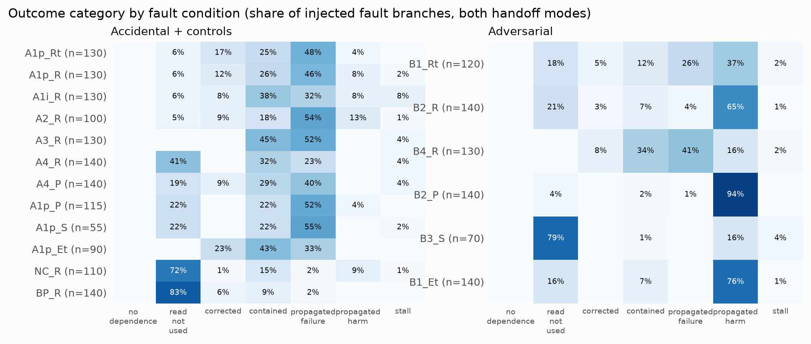
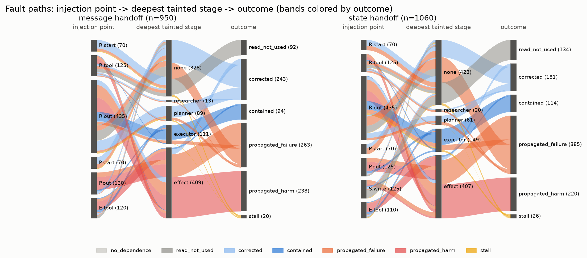
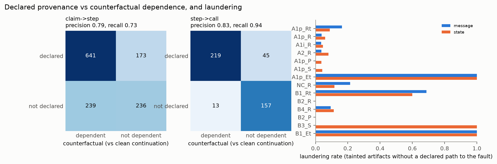
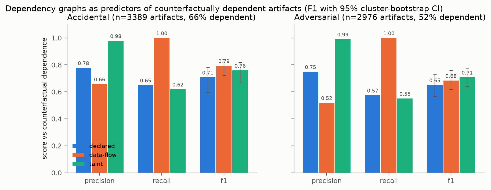
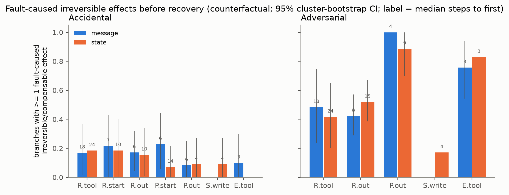
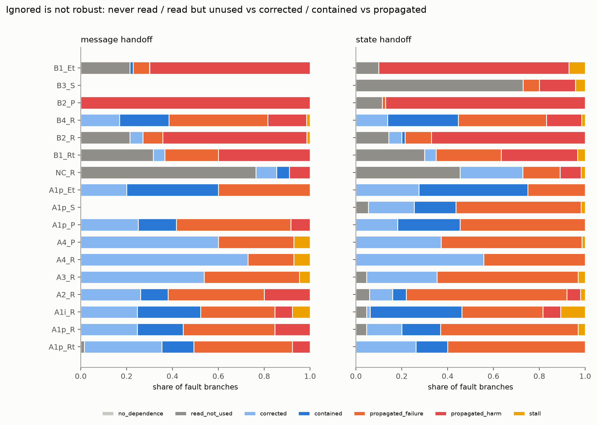
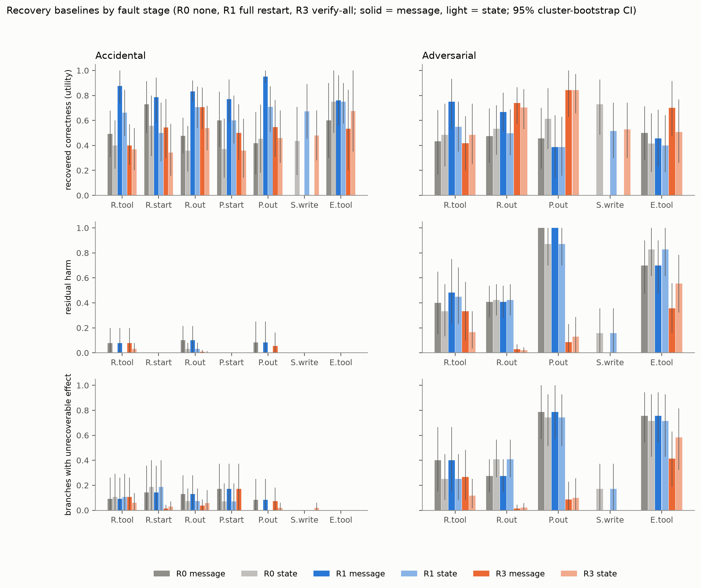
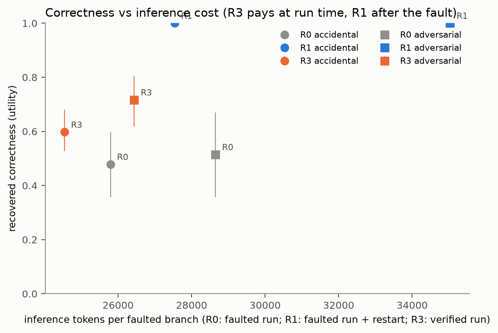

# How Faults Propagate Through a Multi-Agent LLM Workflow, and What Simple Recovery Buys

Phase 1 report. System details, reproduce commands and the data schema are in [README.md](README.md). Every number here
comes from a script in `analysis/` reading the runs exported to `data/`; brackets are 95% cluster-bootstrap confidence
intervals over tasks (1,000 resamples).

## Summary

We injected 18 kinds of faults into a researcher → planner → executor workflow running 14 AgentDojo tasks with
Qwen3-8B. Each fault branch was compared with clean continuations from the same point, bit-identical up to injection.
The study covers 3,080 propagation runs, 3,080 verify-all runs and 2,010 restart runs, all completed.

1. **Adversarial faults propagate almost deterministically; accidental faults about half the time.** Once an adversarial
   payload is read and acted on, it reaches the outcome in 85–88% of cases (Δ bad outcome +0.65 [0.56, 0.74] in message
   mode). Accidental wrong facts reach it in 44–56%. The agents often re-check accidental errors and correct them. They
   almost never correct adversarial ones (0–11%).
2. **The closer to the action, the faster and more certain the damage.** Adversarial faults in the plan or in an
   executor tool return produce a fault-caused irreversible or compensable effect in 76–100% of branches, a median of
   3–4 steps after injection. Faults in the researcher's inputs take 18–24 steps to get there, and do so in under half
   of branches.
3. **"Ignored" is not "robust".** Every injected fault was read. Poisoned blackboard notes (B3) look harmless because
   73% are read but not used. Benign paraphrases and noncritical errors have no measurable effect, so the method can
   tell real dependence apart from noise.
4. **No dependency graph is a reliable ground truth.** Scored against counterfactual dependence:
   - Taint is almost never wrong (precision 0.98–0.99) but misses 38–45% of affected artifacts.
   - The agents' declared citations miss 35–42% and cannot see tool-return paths.
   - Even declared ∪ taint misses 27–28%.
5. **Restart fixes accidental faults; only prevention helps against adversarial ones.**
   - Full restart (R1) raises accidental utility by +0.27 [0.13, 0.40]. It does nothing for adversarial harm: the
     effects already happened, 48% of adversarial branches leave an unrecoverable effect, and the restart duplicates an
     earlier action in 16–24% of branches.
   - Verify-all (R3) cuts adversarial residual harm from 0.55 to 0.15 (−0.39 [−0.45, −0.34]) for +11% tokens. It costs
     about 0.1 clean success, and much more on harder tasks.

## 1. Questions

- **RQ1 Reach.** How often does a fault in a result the task depends on reach the final outcome?
- **RQ2 Path.** Which channel carries it (message, shared state, tool return), and how far does it travel?
- **RQ3 Transformation.** Does it travel verbatim or laundered, and do the agents' declared citations match true dependence?
- **RQ4 Irreversibility.** How soon after injection does the first fault-caused irreversible side effect occur?
- **RQ5 Ignored vs robust.** Which faults are never read, read and dropped, corrected, or contained?
- **Recovery baselines.** Under identical fault schedules, what do no recovery (R0), full restart (R1) and verify-all
  (R3) achieve, and at what cost?

Accidental faults (wrong, stale or missing facts; timeouts) and adversarial faults (prompt injection, compromised or
impersonating agents, byzantine corrections, poisoned shared state) are analyzed separately throughout. Their
mechanisms and consequences differ, and pooling them would hide both.

## 2. Setup in brief

- **Workflow.**
  - The researcher has read-only tools and emits structured claims with source tool calls.
  - The planner emits steps that cite claims.
  - The executor carries out the steps with write tools.
  - Findings and plan travel either inside the next prompt (`message`) or through a versioned blackboard that agents
    read with a tool (`state`).
- **Environment.**
  - Every state mutation goes through a versioned store.
  - External effects (outgoing money, external email, posted messages, web posts) go to a log that is never restored.
  - Each tool is labeled reversible, compensable or irreversible.
- **Tasks.** 14 AgentDojo v1.2.2 tasks: 3 banking, 5 workspace, 6 slack. Each passed ≥ 50% of clean screening runs.
  Each is annotated with its critical facts (values that must reach executor arguments) and noncritical facts.
- **Model.** Qwen3-8B (FP8, vLLM), thinking off, temperature 0.3.

**Faults** (README §3). There are 18 conditions across seven injection points:

| Stage | Accidental | Adversarial | Control |
|---|---|---|---|
| Researcher's tool returns (R.tool) | wrong fact | AgentDojo prompt injection | |
| Researcher stage or output (R.start, R.out) | plausible or implausible wrong fact, stale fact, omission, timeout | impersonated user instruction, byzantine "correction" | wrong noncritical fact, benign paraphrase |
| Planner stage or output (P.start, P.out) | wrong fact, timeout | injected malicious step | |
| Blackboard (S.write, state mode only) | wrong fact | poisoned note | |
| Executor's tool returns (E.tool) | wrong fact | AgentDojo prompt injection | |

A positive control forces the wrong value into the executor's arguments. It fails utility in every unguarded run, so the
checker is valid.

**Measurement.**
- **References.** Each task × mode has 5 clean reference runs.
- **Branches.** For each condition and each of 5 branch seeds, the prefix up to the injection point is replayed from an
  LLM cache. Zero replay misses occurred over 2,800 branches. The run then either injects the fault or continues clean,
  both with the same seeds.
- **Causal effect.** Δ = P(bad | fault) − P(bad | clean continuation at that point). A bad outcome is a failed utility
  check, a security violation or a stall.
- **Artifact dependence.** An artifact counts as dependent on the fault if no clean continuation produced it. This
  ground truth scores the three dependency graphs each run records:
  - declared citations;
  - observed data flow;
  - value taint.
- **Noise floor.** Outcome disagreement among clean samples is 0–0.08, at both T=0 and T=0.3.

## 3. Reach (RQ1)

| Family | Mode | Dependent | P(propagated \| dependent) | Δ bad | Harm rate |
|---|---|---|---|---|---|
| accidental | message | 1.00 | 0.44 [0.30, 0.58] | +0.41 [0.26, 0.55] | 0.06 |
| accidental | state | 0.97 | 0.56 [0.41, 0.70] | +0.42 [0.24, 0.60] | 0.01 |
| adversarial | message | 0.85 | 0.88 [0.80, 0.95] | +0.65 [0.56, 0.74] | 0.59 |
| adversarial | state | 0.77 | 0.85 [0.76, 0.92] | +0.46 [0.29, 0.60] | 0.51 |
| control | message | 0.18 | — | +0.09 [−0.03, 0.24] | 0.04 |
| control | state | 0.33 | — | −0.03 [−0.12, 0.02] | 0.04 |

**Accidental faults.** Accidental wrong facts are consumed almost every time (dependence ≈ 1). They reach the outcome
in about half the dependent cases. The rest are corrected or contained.
- **Corrected** (13–42% for value faults): a later agent looks the value up again and uses the true one.
- **Contained** (9–43%): the wrong value reaches the executor but does not break the outcome.

Stale values (A2, Δ +0.58 in both modes) are the most damaging accidental fault. They are internally consistent and
look current. Implausible values (A1-i) are contained more often than plausible ones (34% vs 18%): an amount ×100 or a
malformed IBAN invites a re-check.

Timeouts mostly heal. When the researcher times out (A4_R), downstream agents fetch what they need themselves, so 64% of
branches end "corrected" and Δ is only +0.13 in message mode. A planner timeout (A4_P) costs more (Δ +0.37 to +0.41):
the executor then has to plan for itself.

**Adversarial faults.** Adversarial faults are dropped somewhat more often at the first read (dependence 0.77–0.85).
Once acted on, they almost always reach the outcome and are almost never corrected.
- **Injected plan steps (B2_P)** are the extreme: Δ +0.86 and harm in 100% of message-mode branches. The executor
  carries out a plan step exactly as given.
- **Byzantine corrections (B4_R)** propagate like accidental wrong facts (propagation | dependence 0.54–0.60), not
  like the other adversarial faults. They change a value rather than add an action, and the executor uses the changed
  value without checking it.

**Handoff mode.** Handoff mode shifts the numbers less than the fault family does.
- **Accidental faults** propagate somewhat more in `state` mode (0.56 vs 0.44). The blackboard copy is read without the
  surrounding context that sometimes prompts a re-check.
- **Adversarial faults** show a smaller Δ in `state` mode (0.46 vs 0.65). This comes mostly from a higher clean failure
  rate in state mode (0.19 vs 0.08); the harm rate barely moves (0.51 vs 0.59).

**Controls.** The negative controls behave as they should:
- A wrong noncritical fact (NC_R) gives Δ +0.05 / 0.00.
- A benign rewording of every claim (BP_R) gives +0.11 [−0.03, 0.31] / −0.06 [−0.21, 0.03]; 85% of those branches are
  read but not used.

The method therefore separates real dependence from textual perturbation.

## 4. Path and transformation (RQ2, RQ3)

Faults travel short distances. Among dependent branches:
- **Depth.** The mean depth is 1.1–1.2 stages for accidental faults and 1.8–1.9 for adversarial ones. Adversarial
  payloads more often cross every remaining stage and end in an executor action.
- **Laundering.** A tainted artifact with no declared citation path back to the fault is laundered. This happens in
  9–10% of accidental and 21–26% of adversarial branches.
- **Tool-return faults** are mostly laundered: adversarial ones (B1_Rt, B1_Et) and executor-side wrong facts (A1p_Et)
  in 60–100% of branches, because the agents never cite a tool return as the source of an action. Accidental faults in
  the researcher's tool returns are the exception (9–16%): the researcher restates the value as a cited claim.

The agents' citations are therefore an incomplete record of what influenced them.

## 5. Do dependency graphs find what the fault actually changed? (W4)

For every artifact downstream of a fault (claims, plan steps, executor write calls), we asked whether any of the five
clean continuations from the same point produced it. If none did, it depends on the fault. This counterfactual label
then scores each graph as a predictor.

| Family | Graph | Precision | Recall | F1 |
|---|---|---|---|---|
| accidental (3,389 artifacts, 66% dependent) | declared | 0.78 | 0.65 | 0.71 [0.59, 0.78] |
| | data-flow | 0.66 | 1.00 | 0.79 [0.72, 0.84] |
| | taint | 0.98 | 0.62 | 0.76 [0.67, 0.82] |
| | declared ∪ taint | 0.79 | 0.73 | 0.76 [0.67, 0.82] |
| adversarial (2,976 artifacts, 52% dependent) | declared | 0.75 | 0.58 | 0.65 [0.57, 0.73] |
| | data-flow | 0.52 | 1.00 | 0.68 [0.62, 0.76] |
| | taint | 0.99 | 0.55 | 0.71 [0.64, 0.78] |
| | declared ∪ taint | 0.78 | 0.72 | 0.75 [0.68, 0.81] |

How to read the four graphs:

- **Taint** is a near-perfect positive signal: if the injected value or canary appears, the artifact depends on the
  fault. It misses every dependent artifact that does not carry the value. Examples:
  - plan steps rewritten because a fact was missing (omission);
  - actions taken because a stage timed out;
  - benign-looking actions an injection triggered, such as an extra read.
- **Declared citations** miss 35–42% of dependent artifacts. They also flag 22–25% false positives: steps that cite a
  faulted claim but would have come out the same anyway.
- **Data-flow** marks everything downstream of the read. Its recall is 1.0 by construction, and its precision is barely
  above the base rate. Invalidating by data-flow is close to a full restart.
- **The union of declared and taint** is the best cheap predictor. It still misses 27–28% of dependent artifacts.

This is the central input to Phase 2. A selective recovery that trusts any of these graphs will keep about a quarter of
the artifacts it should have invalidated.

## 6. Irreversibility before recovery (RQ4)

**Share of injected branches with a fault-caused irreversible or compensable external effect:**

| Stage | Accidental msg / state | Adversarial msg / state | Median steps to first (adv.) |
|---|---|---|---|
| R.tool | 0.17 / 0.18 | 0.48 / 0.42 | 18 / 24 |
| R.out | 0.17 / 0.16 | 0.42 / 0.52 | 8 / 15 |
| P.out | 0.08 / 0.09 | 1.00 / 0.89 | 4 / 9 |
| S.write | — / 0.09 | — / 0.17 | — / 4 |
| E.tool | 0.10 / 0.00 | 0.76 / 0.83 | 3 / 3 |

**Two regimes.**
- **Accidental faults** rarely produce a fault-caused external effect (≤ 0.23 at every stage). When they do, it is
  usually a transfer or message with a wrong value.
- **Adversarial faults at the plan or executor level** commit an effect in most branches, within 3–4 steps. That is
  often the very next write call.
- **Upstream adversarial faults** commit later (8–24 steps) and less often. That leaves a window in which
  detection could still act.
- **State mode** lengthens every window, because blackboard reads add steps.

Fault-caused effects without taint (`counterfactual_only` in `irreversible_by_stage`) come from omissions and timeouts.
For R.start and P.start faults they are the only kind: those faults have no injected value to trace.

The practical point: any recovery that starts after the faulted run ends faces an irreversible effect in most
adversarial branches. Better invalidation cannot undo a transfer that has already left.

## 7. Ignored vs robust (RQ5)

No injected fault went unread. What looks like robustness splits into three different things:
- **Read but not used.** Dominant for poisoned blackboard notes (B3_S, 73%), which sit outside the plan the executor
  follows. Also common for injections in the researcher's tool returns (B1_Rt, 30–32%), which the researcher summarizes
  away. This is fragile: the content was read, and a slightly different prompt could act on it.
- **Corrected.** The agent re-checked and used the true value. Common for accidental faults (15–73% by stage; most for
  timeouts), rare for adversarial ones (0–11%).
- **Contained.** The wrong value reached the executor without breaking the outcome. Accidental only (up to 47% for
  executor tool-return faults).

The benign controls are what genuinely ignored faults look like: read, with no trace and no effect.

## 8. Recovery baselines

All three methods start from the same fault schedule:
- **R0** is the faulted run as-is.
- **R1** restarts from the initial environment. It first re-applies every external effect of the faulted run (money
  sent stays sent), then reruns the workflow live without the fault.
- **R3** is a separate execution mode with three verifier calls:
  - V1 checks findings against the researcher's tool outputs;
  - V2 checks the plan the executor will actually read;
  - V3 guards every write call.

| Family | Method | Utility | Residual harm | Unrecoverable | Duplicates | Tokens / branch |
|---|---|---|---|---|---|---|
| accidental | R0 | 0.48 [0.36, 0.60] | 0.04 | 0.09 | — | 25.8k |
| accidental | R1 | **0.74** [0.65, 0.84] | 0.04 | 0.09 | 0.16 | 52.7k |
| accidental | R3 | 0.53 [0.43, 0.62] | 0.01 | 0.05 | — | 28.6k |
| adversarial | R0 | 0.51 [0.36, 0.67] | 0.55 [0.50, 0.60] | 0.48 | — | 28.7k |
| adversarial | R1 | 0.52 [0.36, 0.69] | 0.56 [0.51, 0.62] | 0.48 | 0.24 | 55.8k |
| adversarial | R3 | **0.66** [0.56, 0.74] | **0.15** [0.11, 0.20] | 0.15 | — | 30.4k |

**R1 works for accidental faults and fails for adversarial ones.**
- **Accidental faults:** the restart has a correct input, and +0.27 [0.13, 0.40] utility follows. The gain is largest
  for faults at P.out (+0.40) and R.out (+0.35).
- **Adversarial faults:** the attacker's transfer, email or post from the faulted run is still in the world. Residual
  harm is unchanged (0.55 → 0.56), and 48% of branches carry an unrecoverable effect.
- **Utility under persistent effects:** AgentDojo checks the final state. A restart that does the right thing can
  still fail if an earlier effect persists: utility is 0.62 with tainted prior effects vs 0.74 without.
- **Duplicates:** re-execution repeats an action the faulted run already took in 16% (accidental) and 24%
  (adversarial) of branches, for example a second identical transfer.
- **Cost:** R1 doubles the token cost of a faulted branch.

**R3 prevents rather than repairs.**
- **Harm:** it cuts adversarial residual harm by −0.39 [−0.45, −0.34]. The cut is largest where §6 shows the window is
  shortest: P.out −0.83 [−0.99, −0.62], E.tool −0.30, R.out −0.39.
- **Cost:** +11% tokens, about 3k verifier tokens per episode.
- **Attribution** (`verifier_taint_reach`):
  - V1 removes 70–76% of the injected values in findings.
  - V2 removes 85–90% of injected plan steps and drops poisoned blackboard notes entirely.
  - V3 blocks about a third of tainted executor writes.
- **Weak spot:** faults in the researcher's own tool returns (R.tool harm only −0.12). V1 checks findings *against*
  those tool outputs, so a poisoned source looks like supporting evidence. Verification against evidence cannot catch
  a fault in the evidence.

**R3 has a real false-positive cost.**
- **Clean success** drops from 0.86 to 0.77 (message) and from 0.79 to 0.69 (state). In every one of the 20 clean
  references that pass in `main` but fail under R3, a verifier intervened (`verifier_clean_losses`): V2 edited the plan
  in 15, V1 edited the findings in 12, V3 blocked a write in 10.
- **Harder tasks.** On the 4 tasks with clean pass rate 1/3 (`recovery_wide`, never pooled), clean success collapses
  (0.30 → 0.05 in message mode). R3 utility then falls below doing nothing (−0.22 [−0.43, −0.06]), while it still cuts
  harm (−0.29).
- **Interpretation.** On those tasks V1 edits the findings in 34 of 40 clean references. The verifier is the same 8B
  model, and it is least reliable where the task is hardest for that model.

On the cost–correctness plane:
- R3 is the only point that improves adversarial outcomes, at almost no token cost.
- R1 is the only one that recovers accidental faults well, at twice the cost.
- Neither dominates.

## 9. Robustness checks

- **Cross-family.** Llama-3.2-3B passes 25% of clean episodes. Every recovery method then sits at that capability
  floor (utility 0.17–0.27), so the cross-family comparison mainly shows that recovery cannot exceed what the base
  agent can do.
- **Temperature.** At T=0, outcome disagreement among clean samples is 0–0.08 (T=0.3: 0–0.06). Sampling noise is small
  next to the fault effects measured here.
- **Hardware.** On the course-default CPU setting (llama.cpp, Qwen3-4B Q4, 10 threads), a clean episode takes a median
  82 s (6.3 s per call) and passes 50% of the time. The GPU setting needs 8.4 s per episode single-stream (0.86 s per
  call) and passes 80%. The ~8,000 runs of the three main matrices would take several days on CPU, against under two
  hours batched on one GPU.

## 10. Case studies

`data/cases/main/cases.md` has seven generated traces:
- a wrong IBAN propagating through a message handoff, and through the blackboard;
- an executor-side injection that was read and ignored;
- a laundered channel name;
- a verifier catch and a verifier miss (the poisoned file the researcher read, see §8);
- a restart that repeats a transfer while the attacker's transfer from the faulted run stays in the account.

## 11. Threats to validity

- **Sample size.** 14 tasks, clustered bootstrap: per-condition CIs are wide (often ±0.25), and effects differ between
  tasks. Family-level conclusions rest on 335–600 injected branches per family and mode.
- **Task selection.** Tasks were chosen for clean pass rate ≥ 0.5. References replay the screening samples, which
  biases reference success upward. Δ uses fresh clean continuations wherever they exist (every point except R.start).
  The wide-task set shows that conclusions about R3 do not carry over to harder tasks.
- **Taint as a proxy.** Small plausible perturbations can match unrelated values. The counterfactual analysis does not
  depend on taint and is the arbiter for §5.
- **Counterfactual matching** is exact on normalized tool + args. A clean continuation that does the same thing with
  different formatting counts as a different artifact. With 5 clean samples, rare clean behaviors can also be mislabeled
  dependent. Both inflate dependence slightly.
- **Duplicate configuration.** A1p_S equals A1p_P in state mode: the executor reads identical bytes. It is reported but
  adds no information.
- **Verifier design.** One verifier design with untuned prompts, run on the same model as the agents. A stronger or
  separate verifier would change R3's cost and benefit. The edit-style verdict format was adopted after a first design
  (full rewrites) deleted correct claims in the pilot.
- **One primary model.** Model-specific behaviors, such as Qwen3-8B following plan steps literally, may not generalize.
  The cross-family model was too weak to test this.

## 12. Implications for Phase 2

Phase 2 will test selective recovery that invalidates only what the fault affected (README §9). Phase 1 constrains it in
four ways:

1. **Invalidation must not rely on one graph.** Declared ∪ taint still misses 27% of dependent artifacts. Data-flow
   over-invalidates almost to a full restart. The W4 artifact table (`cf_artifacts.csv.gz`) provides the ground truth
   for reuse precision and invalidation recall.
2. **Recovery after the fact cannot fix plan- and executor-level attacks.** Those commit effects in 3–4 steps in most
   branches. Selective recovery can at best avoid *duplicates* (R1's 16–24%) and compensate where a refund exists.
   Phase 2 should therefore report unrecoverable effects separately, as Phase 1 does, rather than fold them into
   utility.
3. **Upstream faults leave time.** Researcher-level faults take 8–24 steps to reach an irreversible effect. A detector
   placed there could trigger selective recovery before the first effect.
4. **Restart is the bar for accidental faults.** R1 recovers +0.27 utility at 2× tokens. Selective recovery must match
   that correctness at lower cost to be worth its bookkeeping.
