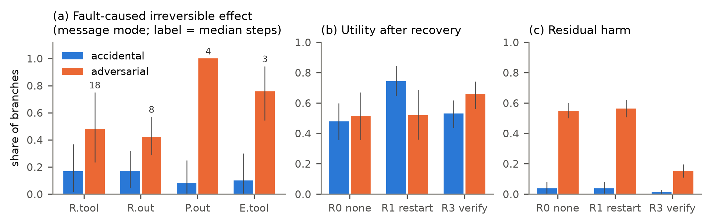

# Fault Propagation and Recovery in a Multi-Agent LLM Workflow — Phase 1

## 1. Problem

Multi-agent LLM systems pass intermediate results between agents and act on the world through tools. When one result is
wrong, through an accidental error or an attack, we do not know how far the error travels, how soon it causes a side
effect that cannot be undone, or whether simple recovery repairs it. Phase 1 measures this causally and evaluates the
recovery baselines that Phase 2's selective recovery must beat.

## 2. System, data and method

- **Workflow.** A researcher (read-only tools, structured claims with sources), a planner (steps that cite claims) and
  an executor (write tools) on 14 AgentDojo v1.2.2 tasks (banking, workspace, slack). Results are handed off either
  inside the next prompt or through a versioned shared blackboard. Every state write is versioned; external effects
  (money sent, emails, posts) go to a log that is never rolled back, and each tool is labeled reversible, compensable or
  irreversible.
- **Faults.** 18 conditions at 7 injection points (researcher tool returns and output, planner output, blackboard,
  executor tool returns). Accidental: wrong, stale or missing facts, timeouts. Adversarial: prompt injection,
  impersonation, byzantine corrections, injected plan steps, poisoned notes. Controls: a wrong noncritical fact, a benign
  paraphrase, and a positive control that forces a wrong argument.
- **Causal measurement.** Each branch replays the clean prefix from an LLM cache (0 replay misses), then continues
  either with the fault or clean, with the same seeds. Effect Δ = P(bad | fault) − P(bad | clean continuation).
  Counterfactual dependence (an artifact no clean continuation produced) is the ground truth for scoring three
  dependency graphs: declared citations, observed data flow, and value taint.
- **Recovery baselines** under identical fault schedules: R0 none, R1 full restart (prior external effects stay),
  R3 verify-all (verifiers on findings, plan and every write).
- **Released data.** 13,433 runs with full traces (Qwen3-8B, vLLM on one RTX 5070 Ti): main 3,080, R3 3,080, R1 2,010,
  plus a harder-task set, a T=0 noise floor, a CPU latency sample and a cross-family check. All tables and figures are
  generated by scripts from `data/`; a fresh clone passes `uv sync && pytest`.

## 3. Results (95% cluster-bootstrap CIs over tasks)

| | Accidental | Adversarial |
|---|---|---|
| P(reaches outcome \| used), message / state | 0.44 / 0.56 | 0.88 / 0.85 |
| Δ bad outcome, message | +0.41 [0.26, 0.55] | +0.65 [0.56, 0.74] |
| Corrected by a later agent (by stage) | 15–73% | 0–11% |
| Fault-caused irreversible effect (plan/executor faults) | ≤ 0.10 | 0.76–1.00, median 3–4 steps |
| Recall of taint / declared ∪ taint vs. true dependence | 0.62 / 0.73 | 0.55 / 0.72 |
| R1 − R0 utility | **+0.27** [0.13, 0.40] | +0.01 [−0.17, 0.18] |
| R3 − R0 residual harm | −0.03 | **−0.39** [−0.45, −0.34] |

1. **Adversarial faults propagate almost deterministically; accidental ones about half the time.** Agents re-check and
   correct wrong facts but follow injected instructions and plan steps literally.
2. **The closer to the action, the faster the damage.** Plan- and executor-level attacks commit an irreversible effect
   in most branches within 3–4 steps; researcher-level faults take 8–24 steps, leaving a window for detection.
3. **"Ignored" is not "robust".** Every fault was read; poisoned notes look harmless only because 73% are read but not
   used. Benign controls have no measurable effect, so the method separates dependence from noise
   (clean-sample disagreement 0–0.08).
4. **No dependency graph is a reliable ground truth.** Taint is precise (0.98–0.99) but misses 38–45% of affected
   artifacts; even declared ∪ taint misses 27–28%. A selective recovery that trusts one graph keeps about a quarter of
   what it should invalidate.
5. **Restart fixes accidental faults; only prevention helps against attacks.** R1 doubles tokens and duplicates an
   earlier action in 16–24% of branches; 48% of adversarial branches already hold an unrecoverable effect. R3 cuts
   adversarial harm for +11% tokens but lowers clean success by ~0.1, and below R0 on harder tasks.

<figure class="wide">
<figcaption><b>Figure 1.</b> (a) Share of injected branches with a fault-caused irreversible or compensable external
effect before any recovery, by injection stage. (b, c) Utility and residual harm under no recovery (R0), full restart
(R1) and verify-all (R3). Bars: 95% cluster-bootstrap CIs over 14 tasks.</figcaption></figure>

## 4. Limitations and next step

14 tasks give wide per-condition CIs, so conclusions are stated per fault family. One primary model; Llama-3.2-3B was too
weak (clean success 0.25) for a cross-family test, so the full matrix is being replicated on more models (Qwen3-4B /
14B and other 8B families). The verifier is the same model as the agents. Phase 2 builds selective recovery on the
hooks already in place (replay cache, per-object restore, external-world log, counterfactual artifact table) and must
match R1's correctness at lower cost without duplicating effects.

---

## Appendix A. Timeline and milestones

**Phase 1 (completed; hours since start of the 21-hour build budget)**

| Milestone | Deliverable and acceptance test | Done at |
|---|---|---|
| M0 Setup | vLLM serving Qwen3-8B FP8, tool call with thinking off, repo and hooks | H0.3 |
| M1–M3 Workflow, tracing, faults | 3 agents on MockLLM; snapshot restore exact; replay with 0 live calls; each fault injects and is detected downstream | H1.1 |
| M4 Runner | matrix expansion, identical fault/clean prefixes, resume without duplicates, 64 concurrent episodes | H1.1 |
| M5 Real runs | screening 33 → 14 tasks, pilot go/no-go, primary matrix, cross-family check | H1.8 |
| W1 Main matrix | 18 conditions × 5 seeds × 2 modes, full traces (3,080 runs) | H2.5 |
| W2–W3 Recovery baselines | R3 verify-all (3,080 runs), R1 restart (2,010 runs) | H3.2 |
| W4–W5 Analysis | counterfactual dependence, graph accuracy, irreversibility, recovery, all figures with CIs | H3.4 |
| W6 Robustness | harder tasks, T=0 noise floor, CPU vs GPU latency, cross-family recovery | H3.8 |
| W7 Submission | README, report, data export, fresh-clone check | H9.3 |
| W8 Breadth | full matrix on Qwen3-4B, Qwen3-14B and two more 8B families | in progress |

**Phase 2 (planned)**

| Week | Milestone | Deliverable |
|---|---|---|
| 1 | R2 rollback-to-fault baseline | whole-snapshot restore + rerun, same fault schedules |
| 2–3 | Selective recovery R4a (declared graph) and R4b (data-flow + taint) | per-object restore, compensation, partial replanning, executor runs only changed steps, valid calls replayed from cache |
| 3 | Validity check | reuse precision and invalidation recall against the Phase 1 counterfactual artifact table |
| 4 | Drift scenario | legitimate world changes before recovery; clobbered changes R2 vs R4b |
| 4–5 | Early detection hook | trigger recovery in the 8–24-step window of upstream faults, before the first irreversible effect |
| 5 | Cross-model replication | recovery comparison on the Phase 1 model set |
| 6 | Final report | correctness, residual harm, unrecoverable effects, duplicates and cost per method |
