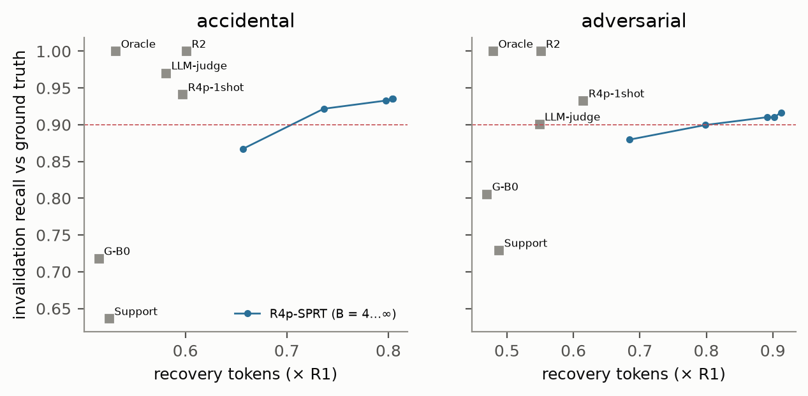

# Selective Recovery with Sequential Probing in a Multi-Agent LLM Workflow

## 1. Problem

A three-agent LLM pipeline (researcher → planner → executor) acts on the world through tools. When one intermediate
result is wrong, by accident or by attack, the run continues and produces later plan steps and tool calls, some of
which change external state. Once the fault is found, recovery must decide which downstream artifacts to recompute and
which to keep. Recomputing everything (restart) is expensive and repeats external effects; keeping too much leaves
corrupted actions in place. Phase 1 measured how faults propagate and showed that no dependency graph read from the
trace finds all dependent artifacts (taint recall 0.55–0.62). Phase 2 asks: can a recovery method certify that it
invalidates the dependent artifacts, at lower cost than restart or rollback?

## 2. Motivation and contribution

Recovery for deterministic programs re-executes and compares (Retro, Warp); LLM producers are stochastic and launder
values through semantics, so a single re-execution cannot tell "depends on the fault" from sampling noise, and literal
taint misses paraphrases, omissions and changed plans. We (1) define *interventional dependence*: artifact u is dependent
if a correct run reproduces it with probability p_u ≤ τ0 = 0.05 and reusable if p_u ≥ τ1 = 0.30, with ground truth from
30 clean continuations; (2) state why static analysis cannot certify recall and what a probing test must cost
(`docs/phase2_theory.md`); (3) build R4p-SPRT, which tests each uncertain artifact with Wald's sequential test on probes;
(4) compare it with eight baselines on 2,105 faulted runs. All definitions, thresholds, the held-out split and the
utility margin were fixed before any recovery run on the real model (`docs/preregistration.md`, Amendments 7–8).

## 3. Design

- **Setting.** A faulted run F is a DAG of artifacts: claims (researcher), plan steps (planner), executor calls. The
  fault location o and the correct value are given (detection oracle; §6 replaces it with real detectors).
- **Recovery episode** (shared by all methods). Rebuild the world by replaying F's calls; correct the origin (uninjected
  findings or plan, a re-executed tool return, or a live rerun of the timed-out agent); decide reuse or invalidation for
  each plan step and executor call; restore invalidated reversible writes per object, refund invalidated payments when
  the recipient is in the account's history, leave irreversible effects in place; replan with reused steps fixed;
  execute only uncovered steps; never repeat an effect that is still in the world.
- **R4p-SPRT.** Invalidate the declared ∪ taint closure. For every other downstream artifact, a probe re-issues the
  request that produced it (rebuilt from F's transcripts) with the corrected parents substituted, at a fresh seed; a
  match adds log(τ1/τ0) = 1.79 to the log-likelihood ratio, a miss −0.31; reuse at ≥ 2.77, invalidate at ≤ −1.56 or after
  8 probes. One planner probe tests all plan steps at once. A budget B caps probes per branch.
- **Baselines.** R0 none; R1 restart; R2 rollback (invalidate everything after the fault); G-B0 (declared ∪ taint,
  no probes); LLM-judge (one same-model call lists dependent artifacts); Support (reuse an artifact whose argument
  values all occur in fault-independent sources, after arXiv 2608.10502); R4p-1shot (one probe, invalidate on mismatch);
  oracle (ground truth).
- **Success criteria** (design §9, on 10 evaluation tasks; budget chosen on 4 held-out tasks): recall ≥ 0.90, observed
  false-reuse ≤ α + 0.05, reuse precision ≥ 0.95, accidental utility non-inferior to R1 at δ = 0.10 (from a power
  simulation), tokens ≤ 0.5 × R1, zero duplicated external effects.

## 4. Implementation

Python 3.12, AgentDojo v1.2.2 (14 banking, workspace and slack tasks), Qwen3-8B-FP8 on vLLM on one 16 GB GPU, thinking
off, T = 0.3, all randomness seeded (recovery 200+, ground truth 300–329, probes 400+). `src/fpr/recovery/` adds ~1,100
lines: faulted-run loader and artifact extraction, probe builders, truncated SPRT, the episode, baselines, ground truth
and two offline detectors. A record/replay cache makes every request content-addressed, so probes and recomputation are
shared across methods and budgets. The runner is resumable and writes a manifest per run. Twenty acceptance tests on a
deterministic mock LLM cover design §10: "none" reproduces R0's final state; rollback equals a clean continuation; no
LLM call before the branch point; per-object restore equals a run that never made the write; refunds succeed only for
known recipients; zero duplicates on every mock branch; a probe rebuilt without correction equals the original request
byte for byte; SPRT decisions match a reference and error rates hold on 10^5 simulated artifacts; budgets are respected;
resume skips finished runs. Before Phase 2 we fixed a harness bug: a call to a tool outside an agent's list returned an
empty message. All Phase 1 baselines were rerun (`*_h2`).

## 5. Evaluation

Runs: 3,080 faulted and clean (main_h2), 2,105 restarts, 4,200 ground-truth continuations, 24 recovery experiments of
2,105 branches each, ≈ 3.5 hours of GPU time. CIs: 95% cluster bootstrap over tasks. Tables: `data/tables/phase2/`.

| Method (acc. / adv.) | Utility | Recall | Reuse prec. | Tokens × R1 |
|---|---|---|---|---|
| R0 | 0.48 / 0.43 | — | — | 0 |
| R1 restart | 0.67 / 0.49 | — | — | 1.00 |
| R2 rollback | 0.82 / 0.56 | 1.00 / 1.00 | — | 0.60 / 0.55 |
| G-B0 | 0.73 / 0.52 | 0.72 / 0.81 | 0.46 / 0.80 | 0.51 / 0.47 |
| LLM-judge | 0.75 / 0.52 | 0.97 / 0.90 | 0.56 / 0.65 | 0.58 / 0.55 |
| Support | 0.72 / 0.53 | 0.64 / 0.73 | 0.48 / 0.74 | 0.52 / 0.49 |
| R4p-1shot | 0.74 / 0.51 | 0.94 / 0.93 | 0.76 / 0.90 | 0.60 / 0.61 |
| R4p-SPRT B=4 | 0.74 / 0.52 | 0.87 / 0.88 | 0.61 / 0.85 | 0.66 / 0.68 |
| R4p-SPRT B=∞ | 0.74 / 0.51 | 0.94 / 0.92 | 0.76 / 0.89 | 0.80 / 0.91 |
| Oracle | 0.78 / 0.52 | 1.00 / 1.00 | 1.00 / 1.00 | 0.53 / 0.48 |

<figure><figcaption>Figure 1. Invalidation recall vs recovery
tokens (evaluation tasks). The dashed line is the 0.90 criterion.</figcaption></figure>

- **Criteria** (R4p-SPRT, B = 4 chosen on held-out tasks): utility non-inferior to R1 (+0.07, lower bound −0.06) and
  zero duplicated external effects (R1: 13% / 18% of branches) pass. Recall 0.87 [0.85, 0.91], reuse precision 0.78,
  tokens 0.65 × R1 and calibration fail. Held-out recall at B = 4 was 0.98 / 0.94, so the budget choice did not transfer.
- **Calibration.** Among probed dependent artifacts, 26% [19%, 34%] were reused at nominal α = 0.05, and the rate does
  not change with α ∈ {0.01, 0.10} or τ1 ∈ {0.2, 0.5}. The control on 550 clean continuations shows the expected side:
  13% of reusable artifacts invalidated (β = 0.20). The guarantee assumes that probe outcomes are draws from the
  distribution that defines dependence (A2). They are not: a probe re-issues F's own request (with F's earlier executor
  turns) with corrected parents, while dependence is defined over a full clean continuation. Probes therefore reproduce
  F's artifacts more often than a correct run does.
- **Rollback wins here.** R2 reaches the highest utility at 0.60 × R1 tokens. Probes re-issue long executor requests,
  while the recomputation they save is a few short calls; selective reuse also keeps calls that a fresh continuation
  would not make (even the oracle, 0.78, stays below R2, 0.82). Residual harm is identical for all methods
  (0.07 / 0.53): harmful effects are irreversible before recovery starts.
- **Static analysis (Prop. 1).** Taint finds 65% / 71% of dependent artifacts; the rest are value substitutions without
  the injected literal (mostly omission and timeout faults), paraphrases (6% / 7%), omissions, added steps and derived
  values (`channels.md`). The LLM-judge reaches recall 0.97 / 0.90 without probes but invalidates most reusable artifacts.
- **Realistic detection** (all tasks). Applying R3's verifier prompts as a detector flags 79% / 87% of faulted branches
  before the flagged action runs; verifier + R2 gives utility 0.74 / 0.72 and adversarial harm 0.08 (R0: 0.50). A
  MELON-style masked re-execution flags 2% / 6%, because most of our injections reach the executor through the plan, not
  through tool outputs.
- **Harness fix.** Returning the error text lowered clean success (state mode 0.79 → 0.60): told that a write tool is
  unavailable, Qwen3-8B tries other write tools and the planner returns an empty plan.

## 6. Related work

MELON (ICML 2025) re-executes with a masked task to *detect* injections; we re-execute to decide *what to recompute*.
Dependency-guided rollback repair (arXiv 2608.10502) uses provenance without a recall guarantee or counterfactual ground
truth; we re-implement its support rule as a baseline. SagaLLM, Atomix and Cordon address compensation and gating of
irreversible actions; Retro and Warp re-execute deterministic programs. Who&When and similar attribution work locate the
root cause, which we take as given. CaMeL prevents injections by control/data-flow separation.

## 7. Experience

- **What failed.** The recall guarantee did not hold on the real model; the mock LLM is deterministic, so every
  acceptance test passed while the key assumption could not fail there. The held-out budget choice did not transfer.
- **What surprised us.** Fixing an obvious harness bug made the agents worse, and rollback beat every selective method.
  Both are reported as measured; changing the harness again would need a new pre-registered amendment.
- **Tricks that worked.** A content-addressed request cache made probes nearly free across methods and budgets (faults
  at the same point share the corrected request) and let 24 recovery experiments share one ground truth. Writing every
  implementation choice into a dated amendment before the first real run kept the analysis honest when results came in
  below the thresholds.
- **Next.** Probes that re-run the whole downstream continuation match the definition of dependence (and cost about as
  much as rollback); a cheaper calibrated proxy, more benchmarks (τ-bench, AppWorld) and the deferred models are Tier 2.
